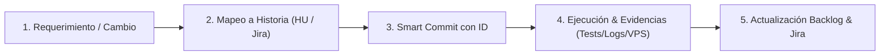

# Regla de Trazabilidad Ágil, Historias de Usuario y Evidencias de Proyecto
**SmartAuditorIA — Proyecto de Gestión de Seguridad y Riesgos TI (SGSI)**

Esta regla es de cumplimiento **MANDATORIO Y PERMANENTE** para todos los procesos de cambio, refactorización, implementación y ejecución técnica realizados en los repositorios de SmartAuditorIA (`smartauditoria_project`, `smartauditoria_backend`, `smartauditoria_frontend`, `smartauditoria_engine`).

---

## 1. Principio Fundamental
> **"Ningún cambio o ejecución técnica ocurre de forma aislada: todo cambio es parte de una Historia de Usuario (HU / Jira Issue) y debe contar con su correspondiente evidencia verificable en los repositorios para alimentar la gestión continua del proyecto."**

---

## 2. Los 4 Pilares del Protocolo de Gestión



### Pilar 1: Mapeo y Creación de Historias de Usuario
1. Antes o durante la implementación de cualquier cambio, se debe identificar la **Historia de Usuario (HU)** a la que pertenece o crear una nueva historia en:
   - [`docs/agile/PRODUCT_BACKLOG.md`](file:///c:/Users/Administrador1/Desktop/Riesgos/smartauditoria_project/docs/agile/PRODUCT_BACKLOG.md)
   - [`docs/agile/jira_integrador_2.csv`](file:///c:/Users/Administrador1/Desktop/Riesgos/smartauditoria_project/docs/agile/jira_integrador_2.csv)
2. Si el cambio responde a un ajuste técnico, bugfix o refactor de una historia existente, debe registrarse como **Criterio de Aceptación (DoD)** o **Sub-tarea** dentro de dicha historia.
3. Cada historia debe contener:
   - **Identificador Único:** `HU-XXX` y clave de Jira (ej. `SCRUM-XX`).
   - **Estructura Ágil:** *Como [Rol], Quiero [Acción], Para [Beneficio]*.
   - **Criterios de Aceptación (Definition of Done - DoD):** Lista verificable punto por punto.
   - **Registro de Evidencia:** Enlace al commit, script de prueba y ambiente verificado.

---

### Pilar 2: Convención de Smart Commits
Todo commit en cualquiera de los repositorios asociados debe seguir estrictamente la convención Smart Commit, vinculando el ticket de Jira y el código de la historia:

$$\text{[TICKET-JIRA][HU-ID] <tipo>(<alcance>): <descripción concisa>}$$

* **Tipos permitidos:** `feat`, `fix`, `refactor`, `style`, `test`, `docs`, `chore`, `ci`.
* **Ejemplos obligatorios:**
  ```bash
  [SCRUM-36][HU-009] feat(auth): implementar módulo de gestión de usuarios y roles RBAC
  [SCRUM-37][HU-010] feat(auth): implementar autoservicio de recuperación de contraseña con token JWT
  [SCRUM-38][HU-011] style(ui): alinear paleta institucional y diseño con Gobernación del Cauca
  [SCRUM-35][HU-008] test(e2e): validar flujo completo de autenticación y roles en VPS de producción
  ```

---

### Pilar 3: Generación y Registro de Evidencias
Cada proceso de cambio o ejecución debe dejar al menos dos formas de evidencia en el repositorio:
1. **Evidencia de Pruebas Automatizadas:**
   - Pruebas unitarias/integración (`pytest` en backend o `vitest` en frontend) o scripts de verificación E2E (`e2e_vps_validation.py`).
   - El resultado de la prueba debe ser documentado o persistido en los reportes de prueba.
2. **Evidencia de Despliegue y Validación:**
   - Si impacta el entorno en vivo (VPS / Cloud), documentar el resultado de la sincronización y la verificación de endpoints HTTP/HTTPS (código de respuesta `200 OK`).
   - Capturas de pantalla o artefactos visuales guardados en la carpeta de evidencias (`docs/` o artefactos del proyecto).

---

### Pilar 4: Alimentación Continua del Proyecto
Al completar la ejecución de cualquier cambio:
1. **Actualizar el Backlog:** Marcar como completada la HU o los criterios de aceptación en `docs/agile/PRODUCT_BACKLOG.md`.
2. **Sincronizar Jira:** Actualizar el archivo de importación/exportación `docs/agile/jira_integrador_2.csv` con el estado y los criterios de aceptación finales.
3. **Informe de Trazabilidad:** Mantener al día la trazabilidad para sustentar la entrega académica y el seguimiento ágil del proyecto.

---

## 3. Matriz de Roles y Responsabilidades
* **ADMIN:** Acceso total a configuración, usuarios y auditorías.
* **OPERADOR:** Gestión operativa de activos, riesgos y ejecución de auditorías.
* **CONSULTOR:** Modo de consulta y lectura de reportes sin permisos de mutación.

*Regla activa y de obligatorio cumplimiento por agentes de IA y desarrolladores del equipo SmartAuditorIA.*
