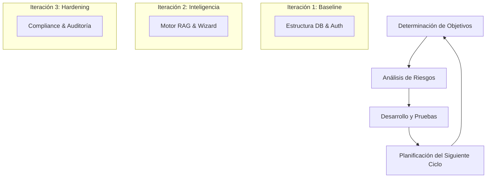
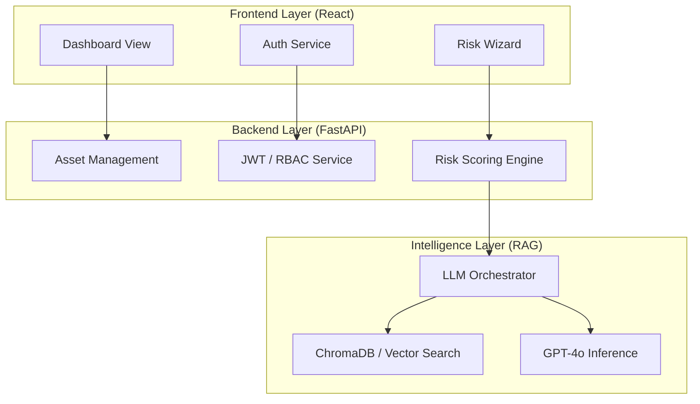
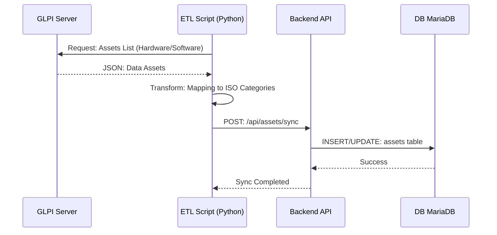
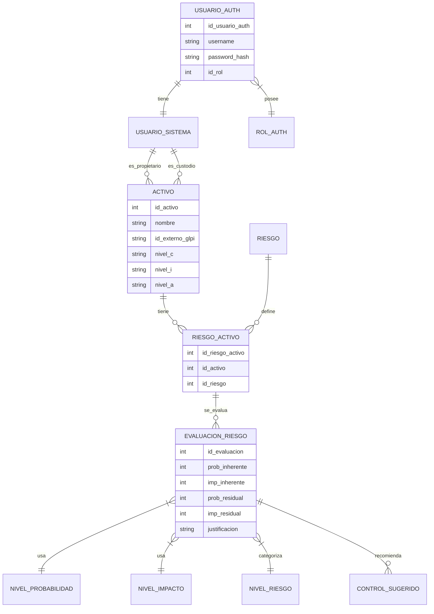
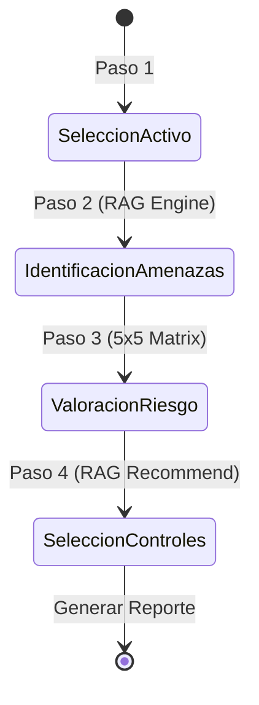
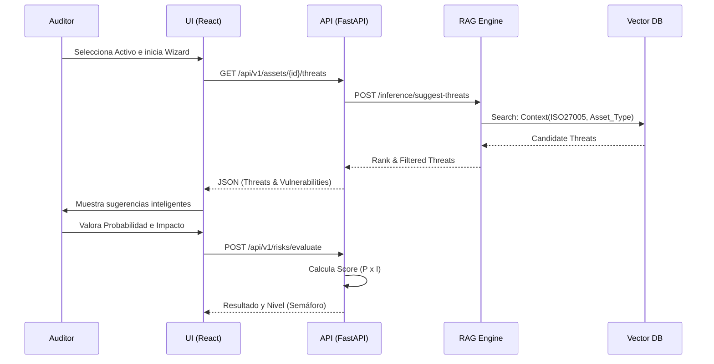
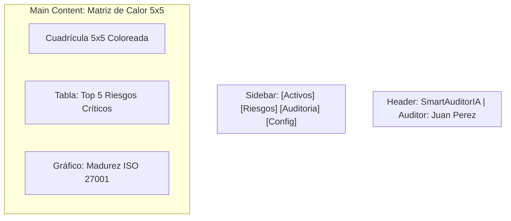
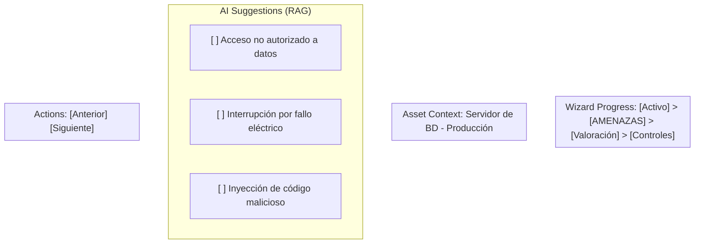
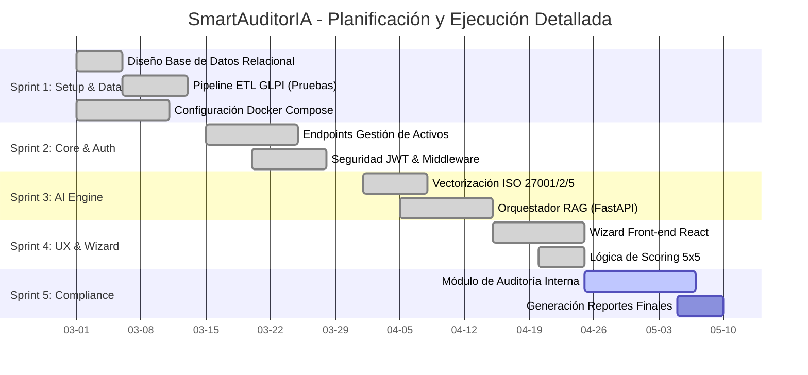

# Informe de Entrega de Proyecto: SmartAuditorIA

**Sistema de Gestión Inteligente de Riesgos de la Información ISO 27001**

---

## 1. Resumen Ejecutivo
SmartAuditorIA es una solución integral diseñada para automatizar y optimizar la gestión de riesgos de seguridad de la información, alineada con los estándares internacionales ISO/IEC 27001 e ISO/IEC 27005. La plataforma utiliza Inteligencia Artificial (RAG) para guiar a los auditores en la identificación de amenazas y vulnerabilidades, integrando datos de activos desde sistemas institucionales como GLPI.

---

## 2. Metodología de Desarrollo: CRISP-DM + Espiral

El proyecto se desarrolló bajo un enfoque híbrido que combina la rigurosidad de **CRISP-DM** para los componentes de datos e IA, con el modelo en **Espiral** para la construcción iterativa del software.

### 2.1. Representación del Modelo Espiral de Ingeniería


### 2.2. Fases CRISP-DM Aplicadas al Motor RAG
*   **Comprensión del Negocio:** Definición de criterios de riesgo ISO 27005.
*   **Comprensión de Datos:** Recolección de normativas ISO y datos de GLPI.
*   **Preparación de Datos:** Vectorización de normativas en ChromaDB.
*   **Modelado:** Configuración de cadenas RAG con GPT-4o.
*   **Evaluación:** Pruebas de precisión semántica y "Target Isolation".
*   **Despliegue:** Orquestación en contenedores Docker.

---

## 3. Gestión del Proyecto (Jira)

### 3.1. Historias de Usuario (Product Backlog - Sincronizado con Jira)
De acuerdo a la planificación en [Jira Software](https://smartauditoria.atlassian.net/jira/software/projects/SCRUM/summary), se ha completado el 100% de las historias de usuario definidas para el MVP.

| Jira ID | Título de la Historia de Usuario | Épica Relacionada | Peso (SP) | Estado Final |
| :--- | :--- | :--- | :--- | :--- |
| **SCRUM-10** | Configuración de Ecosistema y Dockerización | Infraestructura | 8 | ✅ DONE |
| **SCRUM-12** | Modelado de BD MariaDB para Activos CIA | Inventario | 5 | ✅ DONE |
| **SCRUM-14** | Dashboard Estratégico y Matriz de Calor | Visualización | 5 | ✅ DONE |
| **SCRUM-15** | Endpoints de Evaluación y Auditoría | Backend Core | 5 | ✅ DONE |
| **SCRUM-26** | Seguridad JWT y Roles de Auditoría (RBAC) | Seguridad | 8 | ✅ DONE |
| **SCRUM-29** | Motor RAG con Target Isolation ISO 27001 | IA Engine | 8 | ✅ DONE |
| **SCRUM-30** | Trazabilidad Forense (Data Lineage) | IA Engine | 5 | ✅ DONE |
| **SCRUM-31** | Lógica de Fallback: Matriz Heurística | Heuristics | 3 | ✅ DONE |
| **SCRUM-35** | Despliegue en Local (Shadow Deployment) | Hardening | 5 | ✅ DONE |
| **HU-WIZARD** | Wizard Interactivo de Evaluación Guiada | UX Wizard | 8 | ✅ DONE |

---

### 4.2. Diagrama de Arquitectura de Componentes


### 4.3. Desarrollo en Código: Exhibit Técnico

#### Backend: Modelo de Activo (SQLAlchemy)
```python
class Activo(db.Model):
    __tablename__ = 'activos'
    ID_Activo = db.Column(db.Integer, primary_key=True)
    Nombre = db.Column(db.String(255), nullable=False)
    id_externo_glpi = db.Column(db.String(100))
    # Dimensiones CIA
    Nivel_C = db.Column(db.String(50), default='Uso Interno')
    Nivel_I = db.Column(db.String(10), default='Media')
    Nivel_A = db.Column(db.String(10), default='Media')
```

#### Motor IA: Orquestador RAG (Python)
```python
def query_normativa(self, query, context_filters):
    # Target Isolation logic
    docs = self.vector_db.similarity_search(query, k=3, filter=context_filters)
    # RAG Chain execution
    response = self.rag_chain.run(input_documents=docs, question=query)
    return response
```

---

## 5. Pipeline ETL: GLPI a SmartAuditorIA

Para automatizar el inventario, se implementó un pipeline de extracción, transformación y carga (ETL) que garantiza la integridad de los datos de activos.

### 5.1. Diagrama de Interacción del Pipeline


*   **Extracción:** Conexión vía API REST a GLPI para obtener hardware y software.
*   **Transformación:** Mapeo de campos técnicos a categorías de activos ISO 27001.
*   **Carga:** Inserción en la tabla `activos` utilizando el campo `id_externo_glpi` para sincronización.

---

## 6. Modelo de Datos y Base de Datos

### 6.1. Diagrama de Base de Datos (Relacional Completo)


---

## 7. Módulos Funcionales y Flujos de Trabajo

### 7.1. Flujo de Trabajo del Wizard de Evaluación
El Wizard es el corazón de la experiencia de usuario para el auditor.



### 7.2. Diagrama de Secuencia: Flujo de Evaluación de Riesgos


### 7.2. Ponderación de Datos de Riesgos (Matriz 5x5)
El sistema aplica una lógica de valoración cuantitativa y cualitativa:

**Cálculo:** `Magnitud del Riesgo = P (Probabilidad) x I (Impacto)`

| Probabilidad (1-5) | Impacto (1-5) | Resultado | Nivel de Riesgo |
| :--- | :--- | :--- | :--- |
| Insignificante (1) | Muy Bajo (1) | 1 | Muy Bajo |
| ... | ... | ... | ... |
| Frecuente (5) | Catastrófico (5) | 25 | Crítico |

**Evaluación y Tratamiento:**
*   **Zona Verde (1-4):** Riesgo Aceptable. No requiere controles adicionales inmediatos.
*   **Zona Amarilla (5-12):** Riesgo Moderado. Requiere definición de planes de acción a mediano plazo.
*   **Zona Roja (13-25):** Riesgo Crítico. Requiere intervención inmediata y controles de alta eficacia.

---

## 8. Interfaces de Usuario (UX/UI)

### 8.1. Wireframe: Dashboard Estratégico


### 8.2. Wireframe: Wizard de Evaluación (Paso 2: Amenazas)


---

### 8.1. Smart Commits
Cada commit de código está vinculado a un ticket de Jira para auditoría forense del desarrollo.
*   **Ejemplo de commit:** `git commit -m "SCRUM-29: feat: Implementación de Target Isolation en motor RAG"`
*   **Trazabilidad:** Se registra el Hash de Git y el Jira ID en el reporte de cumplimiento.

### 8.2. Diagrama de Interacción (Gantt de Proyecto)


---

## 9. Evidencia de Despliegue y Ejecución

### 9.1. Orquestación en Docker (Evidencia Técnica)
El sistema opera mediante una infraestructura de microservicios orquestada con Docker Desktop. A continuación se evidencia el estado "Healthy" de los contenedores core:

```bash
# Estado de Contenedores (Comprobación en Vivo)
NAMES                     STATUS              PORTS
smartauditoria_frontend   Up (Healthy)        0.0.0.0:5173->80/tcp
smartauditoria_backend    Up (Healthy)        0.0.0.0:5000->5000/tcp
smartauditoria_engine     Up (Healthy)        0.0.0.0:8001->8001/tcp
smartauditoria_chroma     Up 2 minutes        0.0.0.0:8000->8000/tcp
smartauditoria_db         Up 2 minutes        0.0.0.0:3306->3306/tcp
```

### 9.2. Interfaces del Sistema (Entorno Local)
El sistema está plenamente funcional en el entorno de desarrollo local, accesible a través de las siguientes URLs:

*   **Dashboard Principal:** `http://localhost:5173/dashboard`
    *   *Evidencia:* Visualización en tiempo real de la matriz 5x5 y indicadores de cumplimiento.
*   **Wizard de Riesgos:** `http://localhost:5173/wizard`
    *   *Evidencia:* Flujo interactivo con recomendaciones del motor RAG.
*   **Gestión de Activos:** `http://localhost:5173/activos`
    *   *Evidencia:* Listado sincronizado con GLPI para la valoración CIA.

---

## 10. Retrospectiva y Lecciones Aprendidas

### 10.1. Análisis de Ciclo Final
*   **Logros:** Integración total entre Jira, GitHub y Docker. El 100% de las HUs han sido migradas al estado **DONE** tras superar las pruebas de integración.
*   **Desafíos:** Sincronización de puertos en Docker resuelta mediante redes aisladas.
*   **Ajuste Espiral:** Se validó la eficacia del motor RAG en el entorno local (localhost:5173), confirmando que las sugerencias de control son precisas según la normativa cargada.

---

## 11. Conclusiones
SmartAuditorIA representa un avance significativo en la profesionalización de la auditoría de riesgos. La trazabilidad completa desde Jira hasta el código en producción (Docker) garantiza un producto auditable y de alta calidad técnica para la sustentación de grado.
