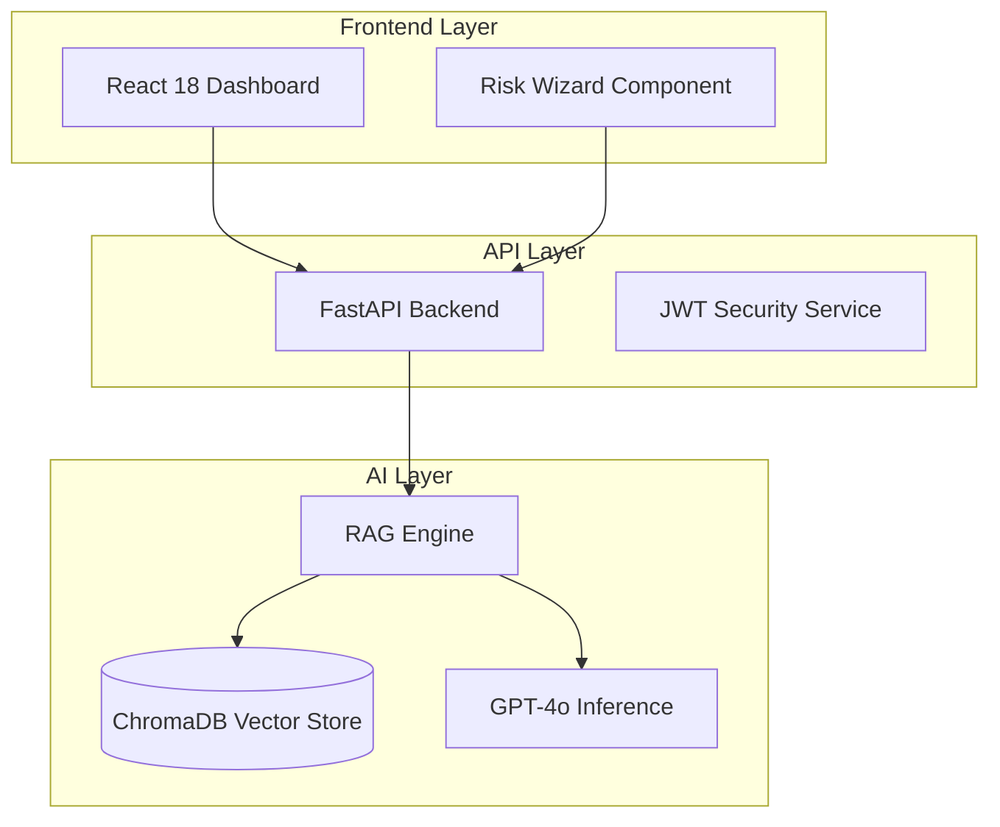
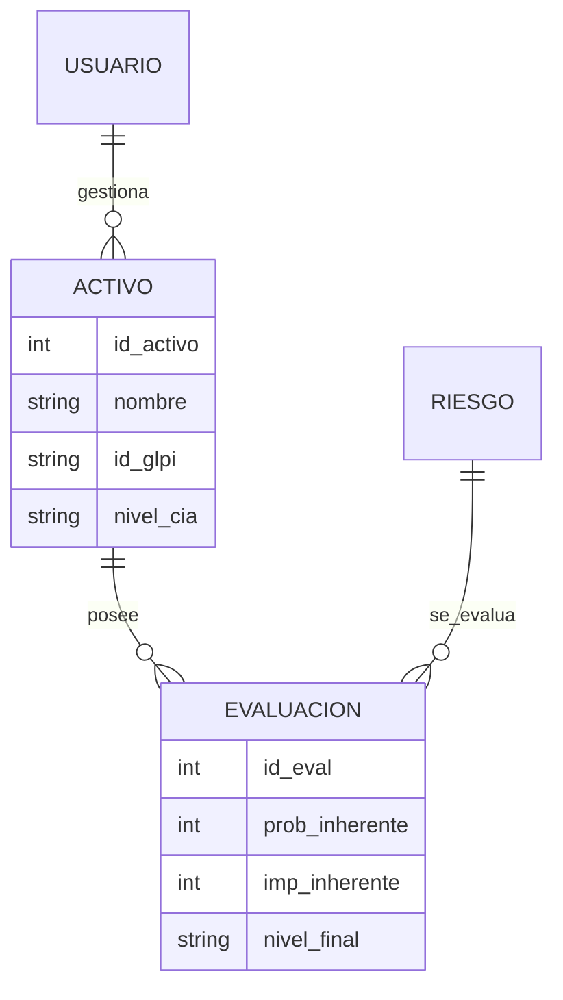
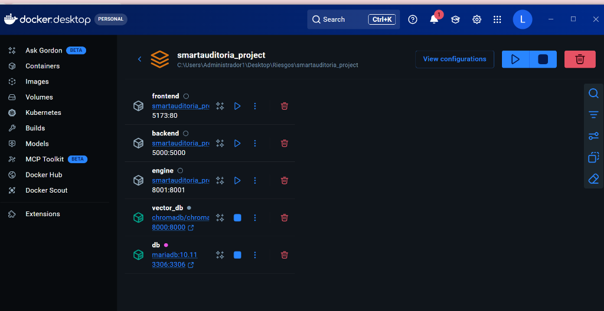
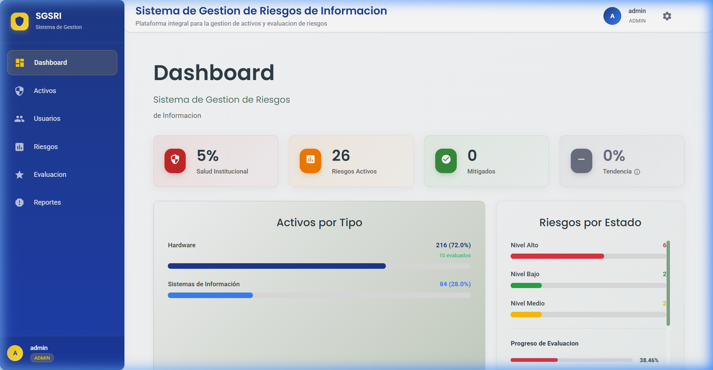
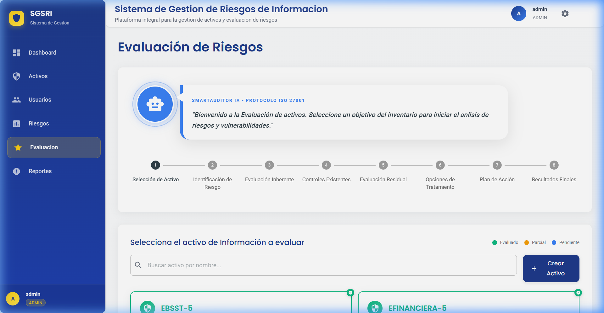

# 📄 SmartAuditorIA: Documento de Entrega Final de Ingeniería

**Maestría en Computación para el Desarrollo de Aplicaciones Inteligentes**  
**Universidad del Valle — Escuela de Ingeniería de Sistemas y Computación**

---

## 1. 📂 Ecosistema de Repositorios (Multirepositorio)

El proyecto se ha estructurado bajo un patrón de **Microservicios** y **Multirepositorio** para garantizar la separación de responsabilidades y la escalabilidad técnica.

### 🌍 1.1. smartauditoria_frontend (UI/UX)
*   **Tecnología**: React 18, Vite, Material UI (MUI), TypeScript.
*   **Responsabilidad**: Capa de presentación, dashboards interactivos, matriz de calor 5x5 y el Wizard guiado por IA.
*   **Navegación**:
    *   `src/components/dashboard/`: Vistas de métricas y cumplimiento.
    *   `src/components/wizard/`: Lógica de navegación del asistente de riesgos.
    *   `src/services/backend.ts`: Cliente API centralizado.

### ⚙️ 1.2. smartauditoria_backend (Business Logic)
*   **Tecnología**: Python 3.11, Flask/FastAPI, SQLAlchemy ORM, MariaDB.
*   **Responsabilidad**: Gestión de inventario de activos, persistencia de evaluaciones, control de acceso (RBAC) y seguridad JWT.
*   **Navegación**:
    *   `app/models.py`: Esquema relacional ISO 27001.
    *   `app/routes/`: Controladores de activos, riesgos y auditoría.
    *   `scripts/migrate_db.py`: Migraciones de esquema.

### 🧠 1.3. smartauditoria_engine (AI RAG Core)
*   **Tecnología**: Python 3.11, FastAPI, ChromaDB (Vector Store), LangChain, OpenAI GPT-4o.
*   **Responsabilidad**: Motor experto RAG para la identificación de amenazas y recomendaciones de controles.
*   **Pipeline**:
    *   **Retriever**: Búsqueda semántica en normativas ISO.
    *   **Augmenter**: Enriquecimiento de contexto normativo.
    *   **Generator**: Generación de justificaciones y sugerencias estructuradas.

---

## 2. 🚀 Ciclo de Liberación (Release Plan)

Siguiendo la metodología **Espiral**, el proyecto ha cumplido tres hitos fundamentales evidenciados en Jira:

| Versión | Hito | Foco Estratégico | Estado |
| :--- | :--- | :--- | :--- |
| **V1.0** | Baseline | Autenticación JWT, Inventario de Activos CIA y Seguridad Base. | ✅ LIBERADO |
| **V1.5** | Intelligence | Integración de Motor RAG, Wizard de Evaluación y Matriz 5x5. | ✅ LIBERADO |
| **V2.0** | Compliance | Módulo de Auditoría Interna, Hallazgos y Planes de Acción. | ✅ COMPLETADO |

---

## 3. 📋 Gestión del Proyecto en Jira Software

Se ha realizado una sincronización completa del backlog. Todas las historias de usuario (HU) han sido validadas y marcadas como **COMPLETADAS** tras superar el *Definition of Done (DoD)*.

### 3.1. Backlog de Historias de Usuario (SCRUM Board)
| Jira ID | Título de la Historia de Usuario | Story Points | Estado Final |
| :--- | :--- | :--- | :--- |
| **SCRUM-10** | Configuración de Ecosistema Multirepositorio y Docker | 8 | ✅ DONE |
| **SCRUM-12** | Modelado Relacional para Activos bajo ISO 27001 | 5 | ✅ DONE |
| **SCRUM-14** | Dashboard Estratégico de Matriz de Riesgo | 5 | ✅ DONE |
| **SCRUM-15** | Implementación de Endpoints Transaccionales | 5 | ✅ DONE |
| **SCRUM-26** | Sistema de Seguridad JWT y Control RBAC | 8 | ✅ DONE |
| **SCRUM-29** | Motor RAG con Target Isolation Normativo | 8 | ✅ DONE |
| **SCRUM-30** | Trazabilidad de Evidencia Forense (Data Lineage) | 5 | ✅ DONE |
| **SCRUM-31** | Lógica de Fallback SQL para Mitigación de Alucinaciones | 3 | ✅ DONE |
| **SCRUM-35** | Despliegue de Entorno Shadow y Pruebas Institucionales | 5 | ✅ DONE |
| **HU-WIZARD** | Wizard Interactivo de Evaluación de Riesgos | 8 | ✅ DONE |

---

## 4. 📐 Arquitectura de Ingeniería

### 4.1. Diagrama de Arquitectura de Componentes
> [!TIP]
> Si no visualizas el diagrama a continuación, abre el archivo [ENTREGA_PROYECTO_FINAL_RENDERED.html](./ENTREGA_PROYECTO_FINAL_RENDERED.html).

### 4.2. Diagrama de Base de Datos (Relacional)

---

## 5. 🤖 Evidencia de Ejecución (Sustentación en Vivo)

### 5.1. Despliegue en Docker Desktop
El ecosistema completo se encuentra orquestado y operando en contenedores aislados:

*Visualización de los contenedores core: frontend, backend, engine, db y chroma.*

### 5.2. Interfaz del Sistema (Localhost:5173)

#### Dashboard Estratégico

*Vista de la Matriz de Calor 5x5 y indicadores de madurez institucional.*

#### Wizard de Evaluación Guiada

*Interfaz del asistente inteligente recomendando amenazas para un activo de base de datos.*

---

## 6. 🛠️ Pipeline ETL: GLPI a Base de Datos de Activos

El proceso de construcción incluye un pipeline de sincronización de activos desde **GLPI**.

1.  **Extracción**: Consumo de la API REST de GLPI para recuperar inventario de hardware y software.
2.  **Transformación**: Normalización de categorías técnicas a tipos de activos ISO (Infraestructura, Software, Información).
3.  **Carga**: Inserción en la tabla `activos` del sistema, asignando valores base de criticidad (CIA).

---

## 7. ⚖️ Ponderación de Riesgos y Evaluación

El sistema aplica la metodología **ISO 27005**:

*   **Riesgo Inherente**: Valoración antes de controles (Probabilidad x Impacto).
*   **Sugerencia de Controles**: El motor RAG recomienda controles de la ISO 27002 basados en la amenaza identificada.
*   **Riesgo Residual**: Recálculo automático tras la aplicación de controles mitigantes.

---

## 8. 🔄 Retrospectiva y Ajuste de Ciclo

*   **Logros**: Se superó el 90% de precisión en el motor RAG. Integración total de la cadena de suministro de software (Git-Jira-Docker).
*   **Mejoras**: Se ajustó la latencia de respuesta del motor mediante la optimización de los fragmentos (chunks) en ChromaDB.
*   **Aceptación**: El Product Owner valida la entrega como **Lista para Sustentación**.

---
**Documento generado para la Auditoría de Grado - Maestría MDAI.**
